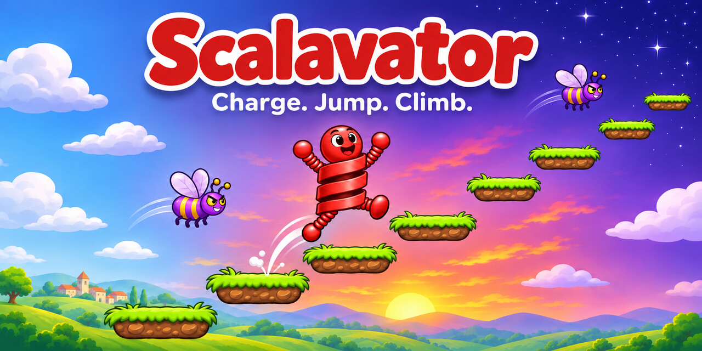
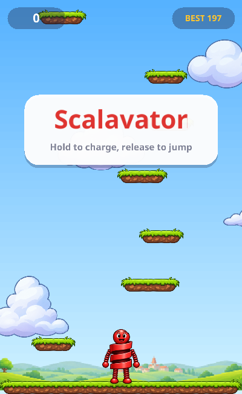
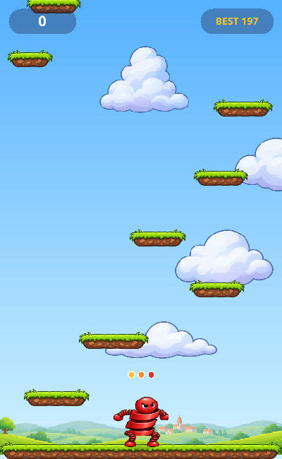
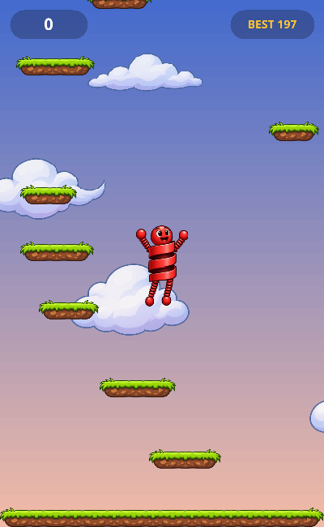
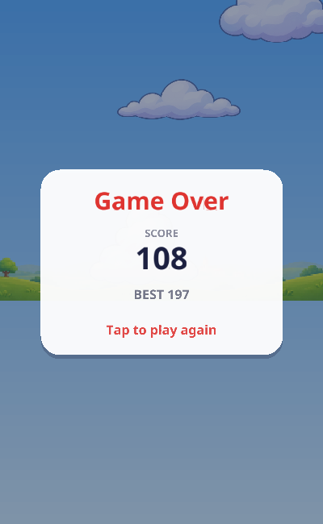
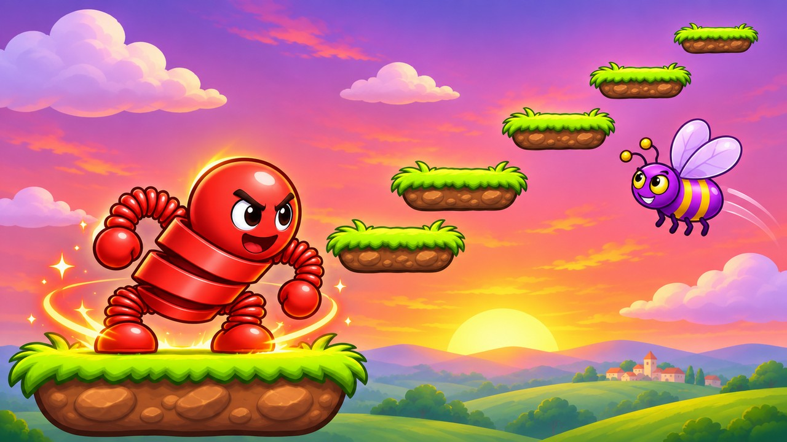

<p align="center">
  
</p>

<p align="center">
  <b>The unofficial Scala game.</b><br>
  A cross-platform arcade game where you jump from platform to platform to reach higher and higher (scores).
</p>

<p align="center">
  <a href="http://regblanc.com/games/scalavator/play.html">Play in your browser</a> ·
  <a href="https://play.google.com/store/apps/details?id=com.regblanc.scalavator">Get it on Google Play</a> ·
  <a href="https://github.com/regb/scala-game-library">Built with SGL</a>
</p>

<p align="center">
  
  
  
  
</p>

## How to play



Hold the mouse button, touch the screen, or hold the space bar to charge a
jump, and release to jump. The longer you charge, the higher you go: the three
dots above the hero show the charge level.

The platforms keep moving, so time your jumps. Watch out for the bugs: one
touch and you tumble down. The sky changes as you climb, from a sunny day to a
sunset, then dusk, and finally the stars.

Scalavator is inspired by the classic [Doodle
Jump](https://wikipedia.org/wiki/Doodle_Jump), but its mechanics are adapted to
be enjoyable on non-mobile platforms such as the web or the desktop, while
keeping controls simple enough to be fully playable on mobile.

<br clear="right">

## Why Scalavator?

Scalavator was started to demonstrate [the Scala Game Library
(SGL)](https://github.com/regb/scala-game-library), a cross-platform game
engine for the Scala programming language. It is a small but complete game,
and a good starting point for your own: the whole game is a few hundred lines
of Scala, shared by every platform.

| Platform | Command |
| --- | --- |
| Desktop (JVM) | `bazel run //:desktop-awt` |
| Web (HTML5, Scala.js) | `bazel run //:html5`, then open `http://localhost:8080` |
| Android | `bazel run //:android-run` |

Android needs a connected device or emulator, and `ANDROID_HOME` pointing to
the Android SDK. Use `bazel build //...` to compile every target.

## Project layout

- [core](/core/src/main/scala): the game, shared by every platform. It uses
  SGL's Screen2D engine: a loading screen, then the main screen.
- [assets/drawable-xxhdpi](/assets/drawable-xxhdpi): the sprites, drawn at
  3x. The build scales them down for lower screen densities.
- [BUILD](/BUILD): Bazel targets. SGL's rules generate the platform entry
  points and the Android Gradle project.
- [desktop](/desktop): the desktop window title.
- [marketing](/marketing): store graphics and screenshots.

## Building against SGL

Scalavator is a standalone Bazel module. SGL is not on the Bazel Central
Registry yet, so [MODULE.bazel](/MODULE.bazel) pins an SGL commit with
`git_override`. To build against a local SGL checkout instead, create a
`.bazelrc.user` (ignored by git) with:

```
common --override_module=sgl.bzl=/path/to/scala-game-library
```

If you build a game with SGL, please reach out to [the SGL
project](https://github.com/regb/scala-game-library), or get in touch directly
with [me](http://regblanc.com/contact/).

## Roadmap

The game evolves along with SGL. The plan is to port it to as many platforms as
possible, most notably iOS and native executables for Windows, macOS, and
Linux, and to show how leaderboards, achievements, and analytics integrate
across all of them from a single Scala code base.

## License and art

The code is under the MIT license.

The current cartoon art, the store graphics, and the banner were generated with
the image tool of the Codex CLI, based on the original character. The original
programmer art is still under [art](/art). Not that anyone would ever need
them, but all the art assets that I provided for the game are released in the
public domain. Some assets in this repository might come from a third-party
source and are thus only reusable under their original terms (usually a
Creative Commons license). If you are of the artistic kind, contributions are
very welcome.

## Credits

* Author, designer, programmer: [Régis Blanc](http://regblanc.com)
* [Ce-gars-là](https://twitter.com/manojah_shanti/status/781884092111548416),
  original concept from [Manohar Jonnalagedda](https://twitter.com/manojah_shanti) and [Nicolas Stucki](https://twitter.com/stucki_nicolas).
